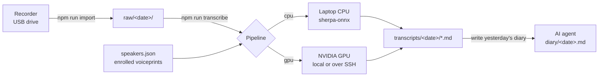

# RecordYourDays

**English** | [简体中文](README.zh-CN.md)

RecordYourDays turns a whole day of audio from a pocket voice recorder into speaker-labeled transcripts, so that an AI agent such as Claude Code or Codex can write your diary and give you honest feedback on your day. It runs entirely on your own machines: a laptop CPU is enough, and a GPU makes it faster and more accurate.

[](LICENSE)
[](package.json)
[](engine/requirements.in)


## Why

You talk to many people every day, but you forget most of it by evening. Wear a cheap recorder for the day, plug it in at night, and ask your agent to "write yesterday's diary". You get:

- **A transcript where every line says who spoke**: you, your family, colleagues you have enrolled, or `其他` (unknown).
- **A diary written from the transcript**: a timeline of the day, plus an outside observer's view of what went well, what could be better, opportunities you missed, and small things to try tomorrow.
- **A notebook you can talk to**: say something to the recorder during the day ("diary, look up X for me tonight"), and the agent picks it up when it writes the diary.

The workflow the agent follows is in [docs/diary-workflow.en.md](docs/diary-workflow.en.md).

## What the output looks like

A transcript line is `[audio position] <speaker> text`. Recognition is tuned for Mandarin Chinese (see [Language support](#language-support)). This is a made-up example:

```text
[00:00] <no speech detected in this segment>
[01:12] 我 早上好，今天先把周报写完。
[01:18] 同事A 十点开会，别忘了带电脑。
[02:05] 其他 请问地铁站往哪边走？
```

(*Me: "Morning, let me finish the weekly report first." Colleague A: "Meeting at ten, don't forget your laptop." Unknown: "Excuse me, which way is the subway?"*)

The diary is a Markdown file the agent writes to `diary/<date>.md`, for example:

```markdown
## Morning
- **09:40** At the stand-up you agreed to send the test report by Friday (0:43:12).

## An outside observer's view
### What went well
- You asked "which part is blocking you?" instead of "why is it late?" (2:15:30).
### Try next
1. Put the Friday report on your calendar now, with a reminder on Thursday.
```

## How it works



1. **Import**: copy the day's files from the recorder (file names must contain the start time, e.g. `20260101_080000.MP3`).
2. **Transcribe**: detect speech, transcribe it, split the audio into speakers, and match each speaker against the voiceprints you enrolled.
3. **Write**: your AI agent reads the transcripts and writes the diary, following the workflow document.

## Two ways to transcribe


| | **CPU** (default) | **GPU** |
|---|---|---|
| Runs on | Your laptop (macOS or Linux) | Linux with an NVIDIA GPU, either the same machine or a GPU host your laptop reaches over SSH |
| Speech recognition | Silero VAD + Zipformer (Chinese/English, with punctuation) | FSMN VAD + Paraformer-large + CT punctuation |
| Who-spoke-when | pyannote segmentation + clustering | DiariZen, plus MossFormer2 to separate two people talking at once |
| Voiceprints | CAM++ | CAM++ (same model) |
| Setup | `npm run models` | `npm run setup-gpu` (builds a Python env and downloads models) |

Both produce the same transcript format, so the diary step doesn't care which one you used. The GPU pipeline separates speakers far better: the CPU pipeline tends to split one person into many small clusters. If the GPU host is unreachable or fails, RecordYourDays falls back to the CPU pipeline unless you turn that off.

## Requirements

**CPU pipeline**
- Node.js 20 or newer
- `ffmpeg` (used to cut voiceprint clips)
- `tar` with bzip2 (used by `npm run models`)
- About 200 MB of disk space for models

**GPU pipeline** (optional)
- Linux, an NVIDIA driver that supports CUDA 12, Python 3.10, `ffmpeg`, `git`, `bash`, `flock` and `setsid` (util-linux). CUDA libraries come from the PyTorch wheels; you don't need a system CUDA install.
- For a remote GPU host: `ssh` and `rsync` on both machines, and key-based SSH login from the laptop.

**A recorder**: any recorder that mounts as a USB drive and names files by start time. Set "record all day" (not voice-activated) mode, or the audio positions will drift away from real clock time.

## Quick start (CPU)

```bash
git clone https://github.com/weidwonder/RecordYourDays.git
cd RecordYourDays
npm ci
cp dairy.config.example.json dairy.config.json   # then edit recorder.dir and timeZone
npm run models                                   # download the CPU models (~200 MB)
```

Enroll your own voice once. Put a recording in `raw/<date>/`, find 10–60 seconds where only you are speaking, and enroll that range (positions are inside the recording, in seconds or `h:mm:ss`):

```bash
npm run voice -- add 我 20260101_080000 0:05 0:45 --whole --role family
```

This creates `speakers.json`. The first argument is the name, and it is also the label shown in transcripts. Enroll family members the same way.

Then, every day:

```bash
npm run run                     # import yesterday's recordings and transcribe them
npm run run -- 2026-01-01       # or a specific day
```

Finally, open the project in your AI agent and say "write yesterday's diary". The agent reads `CLAUDE.md` / `AGENTS.md`, which point it to the [diary workflow](docs/diary-workflow.en.md).

## GPU setup

**On a Linux machine with an NVIDIA GPU** (everything runs locally). In `dairy.config.json`, set `"engine": "gpu"`, then run:

```bash
npm run setup-gpu
npm run run
```

**From a laptop, using a GPU host over SSH.** Add a `remote` section under `gpu` in `dairy.config.json`:

```json
{
  "engine": "gpu",
  "gpu": {
    "remote": {
      "host": "user@gpu-host",
      "identityFile": "~/.ssh/id_ed25519",
      "workDir": "~/record-your-days"
    }
  }
}
```

Then run `npm run setup-gpu` once. After that, each transcription syncs the code, your config, `speakers.json`, voiceprint clips and the day's audio to the host, runs there, and pulls the transcripts back. Set `"storage": "remote"` if you want recordings kept only on the GPU host and not on the laptop.

## Voiceprints

Speakers are matched against the people in `speakers.json`. People have a `role`: `family` for family members and `known` for anyone else you meet often, such as colleagues. Enrolling colleagues matters: otherwise they can only be matched against your family, and a colleague may be labeled as your partner.

```bash
npm run voice -- clusters 2026-01-01                    # who talked when, and who they were matched to (GPU pipeline)
npm run voice -- add-cluster 同事A 2026-01-01 20260101_080000 3   # enroll a whole cluster as a person (GPU pipeline)
npm run voice -- add 同事A 20260101_080000 1:20:00 1:25:00        # enroll a time range (GPU pipeline)
npm run voice -- add 我 20260101_080000 0:05 0:45 --whole          # enroll a range as-is (works with CPU only)
npm run voice -- check                                  # find clips that sound more like someone else
npm run transcribe -- 2026-01-01 --relabel-only         # re-match speakers after editing speakers.json (seconds)
```

Other subcommands: `list`, `remove`, `rename`, `set` (role, display label, threshold), `migrate`, `sync`. Run `npm run voice` to see them all.

Tips:
- Aim for 10–20 clean clips, 30–120 seconds in total, per person.
- Start people you rarely meet at a threshold of 0.6 (`npm run voice -- set <name> --threshold 0.6`), so strangers aren't matched to them.
- Don't enroll strangers you met once.

## Commands

| Command | What it does |
|---|---|
| `npm run import -- [date]` | Copy the day's recordings from the recorder into `raw/<date>/` (or to the GPU host when `storage` is `remote`) |
| `npm run transcribe -- [date] [--force \| --relabel-only] [--engine cpu\|gpu] [--no-fallback]` | Transcribe into `transcripts/<date>/` |
| `npm run run -- [date] [--force] [--engine cpu\|gpu] [--no-fallback] [--keep-recorder \| --delete-recorder]` | Import, transcribe, then optionally delete the originals from the recorder |
| `npm run models` | Download the CPU models (skips models already present) |
| `npm run setup-gpu` | Build the GPU Python environment and download its models (locally or on `gpu.remote`) |
| `npm run voice -- <subcommand>` | Manage voiceprints (see above) |
| `npm test` | Run the Node and Python unit tests |

- The date defaults to yesterday in the configured `timeZone`.
- `--force` ignores the cache and transcribes again.
- `--no-fallback` reports an error instead of falling back to the CPU pipeline when the GPU pipeline fails.
- Originals on the recorder are deleted only when the copy's sha256 matches and the transcript exists. Deletion is off by default (`recorder.deleteAfterTranscribe`).

## Configuration

`dairy.config.json` (copy it from [dairy.config.example.json](dairy.config.example.json)):

| Key | Default | Meaning |
|---|---|---|
| `timeZone` | the system time zone | Decides what "yesterday" is and which day a recording belongs to (IANA name, e.g. `Asia/Shanghai`) |
| `engine` | `cpu` | Default pipeline: `cpu` or `gpu` |
| `fallbackToCpu` | `true` | Fall back to the CPU pipeline if the GPU pipeline is unreachable or fails |
| `unknownLabel` | `其他` | Label for unrecognized speakers |
| `modelDir` | `~/.cache/record-your-days/models/sherpa-onnx` | CPU model directory |
| `numThreads` | `4` | CPU inference threads |
| `storage` | `local` | `remote` keeps recordings only on the GPU host (requires `gpu.remote`) |
| `recorder.dir` | none | Folder on the mounted recorder that holds the recordings (required for `import` / `run`) |
| `recorder.pattern` | `YYYYMMDD_HHmmss` | File name pattern, without extension |
| `recorder.extensions` | `[".MP3"]` | Audio extensions to import |
| `recorder.timeZone` | same as `timeZone` | Time zone of the time in the file names |
| `recorder.deleteAfterTranscribe` | `false` | Delete the originals from the recorder after a verified run |
| `gpu.envDir`, `gpu.modelRoot` | under `~/.cache/record-your-days/` | Python environment and model directory for the local GPU pipeline |
| `gpu.remote` | none | GPU host over SSH: `host` (required), `port`, `identityFile`, `workDir`, `envDir`, `modelRoot` |
| `gpu.*` | see [config.py](engine/dairy_engine/config.py) | GPU pipeline parameters (batch sizes, matching thresholds, overlap separation, GPU selection) |

`speakers.json` is a list of people: `name`, `role` (`family` or `known`), `display` (the label written in transcripts), `threshold`, and `enroll` (the voiceprint clips). You normally edit it through `npm run voice`. See [speakers.example.json](speakers.example.json).

## Privacy


- Recordings, transcripts, diaries, caches and voiceprint clips stay on your laptop and your own GPU host. Nothing is uploaded to a cloud speech service.
- `raw/`, `transcripts/`, `diary/`, `cache/`, `voiceprints/clips/`, `memory/` and your real config files are in `.gitignore`.
- The AI agent that writes the diary does read your transcripts. Pick an agent and a plan whose data policy you are comfortable with.
- **Be careful when recording other people.** Voiceprints are biometric data, and many jurisdictions (for example China's Personal Information Protection Law and the EU's GDPR) treat them as sensitive personal information that needs consent. Recording conversations may also need consent where you live. Don't enroll people without their agreement, and don't publish recordings or transcripts of others.

## Going further: chat messages

If your agent can also read your WeChat, Feishu/Lark or other chat history, it can analyze the day's work and personal messages together with the recordings. This project doesn't include any chat connector. Check the platform's terms and local law before you connect one.

## Language support

Both pipelines are tuned for Mandarin Chinese. The CPU recognizer also handles English and Chinese-English mixed speech. The GPU recognizer (Paraformer) is a Chinese model. To use another language, you would swap the speech recognition model; speaker separation and voiceprints mostly don't depend on the language.

## Models and licenses

The code in this repository is MIT-licensed. The models are downloaded from their official sources and keep their own licenses:

| Model | Used by | License |
|---|---|---|
| [sherpa-onnx](https://github.com/k2-fsa/sherpa-onnx) runtime | CPU | Apache-2.0 |
| Zipformer zh-en with punctuation ([X-ASR](https://github.com/Gilgamesh-J/X-ASR)) | CPU | Apache-2.0 |
| [Silero VAD](https://github.com/snakers4/silero-vad) | CPU | MIT |
| [pyannote segmentation 3.0](https://huggingface.co/pyannote/segmentation-3.0) | CPU | MIT |
| [3D-Speaker CAM++](https://github.com/modelscope/3D-Speaker) | CPU, GPU | Apache-2.0 |
| [FunASR](https://github.com/modelscope/FunASR) Paraformer-large, FSMN VAD, CT punctuation | GPU | Apache-2.0 |
| [MossFormer2_SS_16K](https://modelscope.cn/models/alibabasglab/MossFormer2_SS_16K) | GPU | Apache-2.0 |
| [WeSpeaker ResNet34-LM](https://huggingface.co/pyannote/wespeaker-voxceleb-resnet34-LM) | GPU | CC-BY-4.0 |
| [DiariZen](https://github.com/BUTSpeechFIT/DiariZen) code | GPU | MIT |
| [DiariZen WavLM weights](https://huggingface.co/BUT-FIT/diarizen-wavlm-large-s80-md-v2) | GPU | **CC BY-NC 4.0, non-commercial use only** |

Because of the DiariZen weights, the GPU pipeline as shipped is for non-commercial use. For commercial use, replace the diarization model.

## Status and limitations

- This is a personal tool, made public. The CPU pipeline is tested end to end on macOS. The GPU pipeline has been used daily on a Linux host with two RTX 2080 Ti cards (about 48 minutes for 13 hours of audio). The open-source way of running it (`setup-gpu`, local GPU, and the `gpu.remote` SSH config) is new and has only been checked with unit tests. Please open an issue if it breaks.
- Speaker labels are not always right: two people in one sentence, similar voices, and loudspeakers (TV, subway announcements) cause mistakes. The diary workflow tells the agent to treat labels with caution.
- Children's voices change quickly; re-enroll them every month or two.

## Contributing

Issues and pull requests are welcome. Please run `npm test` before sending a PR (it runs the Node tests and the Python unit tests). Never include real recordings, transcripts or voiceprints in issues or PRs.

## License

[MIT](LICENSE) for the code. Model weights have their own licenses; see [Models and licenses](#models-and-licenses).
