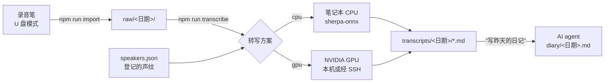

# RecordYourDays

[English](README.md) | **简体中文**

RecordYourDays 把录音笔录下的一整天音频，转成每句都标好说话人的转写稿，再交给 Claude Code、Codex 这类 AI agent 写成日记，并给你一份直言不讳的复盘。全程只在你自己的机器上运行：笔记本的 CPU 就够用，有 GPU 会更快、更准。

[](LICENSE)
[](package.json)
[](engine/requirements.in)


## 为什么做这个

每天要和很多人说很多话，到了晚上大多已经忘了。白天戴着一支便宜的录音笔，晚上插上电脑，对 agent 说一句“写昨天的日记”，你会得到：

- **每句都知道是谁说的转写稿**：你自己、家人、登记过的同事，认不出的标成“其他”。
- **根据转写稿写成的日记**：按时间线记下这一天，再从旁观者的角度说说哪里做得好、哪里可以更好、你可能错过了什么机会、明天可以试试什么。
- **一个能对着说话的记事本**：白天随口对录音笔说一句（“diary，晚上帮我查一下××”），agent 写日记时会照办。

agent 写日记的流程见 [docs/diary-workflow.md](docs/diary-workflow.md)。

## 结果长什么样

转写稿每行的格式是 `[音频位置] <说话人> 文本`。下面是虚构的例子：

```text
[00:00] <no speech detected in this segment>
[01:12] 我 早上好，今天先把周报写完。
[01:18] 同事A 十点开会，别忘了带电脑。
[02:05] 其他 请问地铁站往哪边走？
```

日记是 agent 写到 `diary/<日期>.md` 的 Markdown 文件，比如：

```markdown
## 上午
- **09:40** 晨会上你答应周五前把测试报告发出去（0:43:12）。

## 旁观者视角
### 做得好的
- 你问的是“卡在哪一步了？”，而不是“怎么又晚了？”（2:15:30）。
### 接下来可以试试
1. 现在就把周五交报告写进日历，周四设个提醒。
```

## 工作原理



1. **导入**：从录音笔拷出当天的录音。文件名里要带开始时刻，例如 `20260101_080000.MP3`。
2. **转写**：找出有人说话的片段，转成文字，分出不同的说话人，再和你登记过的声纹逐一比对，认出是谁。
3. **写日记**：AI agent 读转写稿，按流程文档写日记。

## 两种转写方式


| | **CPU**（缺省） | **GPU** |
|---|---|---|
| 在哪跑 | 你的笔记本（macOS 或 Linux） | 装了 NVIDIA 显卡的 Linux：本机直接跑，或者由笔记本通过 SSH 交给一台 GPU 主机 |
| 语音识别 | Silero VAD + Zipformer（中英文，带标点） | FSMN VAD + Paraformer-large + CT 标点 |
| 分说话人 | pyannote 分割 + 聚类 | DiariZen；两人同时说话时再用 MossFormer2 分离 |
| 声纹 | CAM++ | CAM++（同一个模型） |
| 安装 | `npm run models` | `npm run setup-gpu`（建 Python 环境并下载模型） |

两种方式输出的转写稿格式完全一样，写日记这一步不用区分。GPU 方案分说话人准得多，CPU 方案容易把同一个人切成很多个小簇。GPU 主机连不上或者转写失败时，会自动退回 CPU 方案，也可以关掉这个行为。

## 前置条件

**CPU 方案**
- Node.js 20 或更高版本
- `ffmpeg`（裁声纹片段用）
- 支持 bzip2 的 `tar`（`npm run models` 解压模型用）
- 模型约占 200 MB 磁盘

**GPU 方案**（可选）
- Linux，NVIDIA 驱动要支持 CUDA 12；Python 3.10、`ffmpeg`、`git`、`bash`，以及 util-linux 里的 `flock`、`setsid`。CUDA 运行库由 PyTorch 的 wheel 自带，不用另装系统 CUDA。
- 用远程 GPU 主机时：两台机器都要有 `ssh` 和 `rsync`，笔记本要能免密 SSH 登录主机。

**录音笔**：能当 U 盘挂载、文件名按开始时刻命名的录音笔都可以。请设成“全天录音”，不要用“声控录音”，否则音频位置和实际时间会越差越多。

## 快速上手（CPU）

```bash
git clone https://github.com/weidwonder/RecordYourDays.git
cd RecordYourDays
npm ci
cp dairy.config.example.json dairy.config.json   # 然后改 recorder.dir 和 timeZone
npm run models                                   # 下载 CPU 方案的模型（约 200 MB）
```

先登记一次你自己的声纹：把一段录音放进 `raw/<日期>/`，找出其中 10–60 秒只有你一个人在说话的时间，按这个时间段登记（时间是录音内的位置，写秒数或 `h:mm:ss`）：

```bash
npm run voice -- add 我 20260101_080000 0:05 0:45 --whole --role family
```

这一步会生成 `speakers.json`。第一个参数是名字，也是转写稿里显示的标签。家人也按同样的方法登记。

之后每天：

```bash
npm run run                     # 导入昨天的录音并转写
npm run run -- 2026-01-01       # 或者指定日期
```

最后在 AI agent 里打开这个项目，说“写昨天的日记”。agent 会读 `CLAUDE.md` / `AGENTS.md`，按里面指向的[写日记流程](docs/diary-workflow.md)做。

## 配置 GPU

**在装了 NVIDIA 显卡的 Linux 上**（全部在本机跑）：在 `dairy.config.json` 里设 `"engine": "gpu"`，然后：

```bash
npm run setup-gpu
npm run run
```

**笔记本通过 SSH 用 GPU 主机**：在 `dairy.config.json` 的 `gpu` 下加一段 `remote`：

```json
{
  "engine": "gpu",
  "gpu": {
    "remote": {
      "host": "user@gpu-host",
      "identityFile": "~/.ssh/id_ed25519",
      "workDir": "~/record-your-days"
    }
  }
}
```

先跑一次 `npm run setup-gpu`。之后每次转写，都会把代码、配置、`speakers.json`、声纹片段和当天的录音同步到主机上，在那里跑完，再把转写稿拉回来。如果想让录音只存在 GPU 主机上、笔记本不留，设 `"storage": "remote"`。

## 声纹

认人时，会拿说话人和 `speakers.json` 里的人逐一比对。每个人有一个 `role`：家人用 `family`，其他经常见面的人（比如同事）用 `known`。同事最好也登记：不登记的话，他们只能和你的家人比对，同事可能会被标成你的家人。

```bash
npm run voice -- clusters 2026-01-01                    # 谁在什么时段说话、被认成了谁（GPU 方案）
npm run voice -- add-cluster 同事A 2026-01-01 20260101_080000 3   # 把整个簇登记成某人（GPU 方案）
npm run voice -- add 同事A 20260101_080000 1:20:00 1:25:00        # 按时间段登记（GPU 方案）
npm run voice -- add 我 20260101_080000 0:05 0:45 --whole          # 整段原样登记（只有 CPU 方案也能用）
npm run voice -- check                                  # 找出更像别人的片段
npm run transcribe -- 2026-01-01 --relabel-only         # 改了 speakers.json 后只重算认人，几秒钟
```

其他子命令有 `list`、`remove`、`rename`、`set`（改角色、显示名、阈值）、`migrate`、`sync`。执行 `npm run voice` 可以看到全部。

几点建议：
- 每人 10–20 个干净的片段，合计 30–120 秒为宜。
- 不常见面的人，阈值从 0.6 起步（`npm run voice -- set <名字> --threshold 0.6`），免得陌生人被认成他们。
- 只见过一次的陌生人不要登记。

## 命令

| 命令 | 作用 |
|---|---|
| `npm run import -- [日期]` | 把当天的录音从录音笔拷到 `raw/<日期>/`（`storage` 为 `remote` 时直接传到 GPU 主机） |
| `npm run transcribe -- [日期] [--force \| --relabel-only] [--engine cpu\|gpu] [--no-fallback]` | 转写到 `transcripts/<日期>/` |
| `npm run run -- [日期] [--force] [--engine cpu\|gpu] [--no-fallback] [--keep-recorder \| --delete-recorder]` | 导入、转写，再按设置删除录音笔上的原件 |
| `npm run models` | 下载 CPU 方案的模型，已有的跳过 |
| `npm run setup-gpu` | 建 GPU 方案的 Python 环境并下载模型（本机，或者 `gpu.remote` 上） |
| `npm run voice -- <子命令>` | 管理声纹，见上一节 |
| `npm test` | 跑 Node 和 Python 的单元测试 |

- 日期缺省是配置的 `timeZone` 下的昨天。
- `--force` 忽略缓存，重新转写。
- `--no-fallback`：GPU 方案失败时直接报错，不退回 CPU 方案。
- 录音笔原件只在两个条件都满足时才删：拷贝的 sha256 和原件一致，转写稿已经生成。缺省不删，由 `recorder.deleteAfterTranscribe` 控制。

## 配置

`dairy.config.json`（从 [dairy.config.example.json](dairy.config.example.json) 复制）：

| 配置项 | 缺省值 | 含义 |
|---|---|---|
| `timeZone` | 系统时区 | 决定“昨天”是哪天、录音归哪一天，写 IANA 名称，如 `Asia/Shanghai` |
| `engine` | `cpu` | 缺省的转写方案：`cpu` 或 `gpu` |
| `fallbackToCpu` | `true` | GPU 方案连不上或失败时退回 CPU 方案 |
| `unknownLabel` | `其他` | 认不出的说话人用的标签 |
| `modelDir` | `~/.cache/record-your-days/models/sherpa-onnx` | CPU 方案的模型目录 |
| `numThreads` | `4` | CPU 推理线程数 |
| `storage` | `local` | 设为 `remote` 时录音只存 GPU 主机（需要配 `gpu.remote`） |
| `recorder.dir` | 无 | 录音笔挂载后存录音的目录，`import` / `run` 必填 |
| `recorder.pattern` | `YYYYMMDD_HHmmss` | 文件名规则，不含扩展名 |
| `recorder.extensions` | `[".MP3"]` | 要导入的音频扩展名 |
| `recorder.timeZone` | 同 `timeZone` | 文件名里的时间所在的时区 |
| `recorder.deleteAfterTranscribe` | `false` | 核对无误后删除录音笔原件 |
| `gpu.envDir`、`gpu.modelRoot` | 在 `~/.cache/record-your-days/` 下 | 本机 GPU 方案的 Python 环境和模型目录 |
| `gpu.remote` | 无 | 经 SSH 使用的 GPU 主机：`host`（必填）、`port`、`identityFile`、`workDir`、`envDir`、`modelRoot` |
| `gpu.*` | 见 [config.py](engine/dairy_engine/config.py) | GPU 方案的参数（批大小、认人阈值、重叠分离、选卡） |

`speakers.json` 是一个人员列表，每人有 `name`、`role`（`family` 或 `known`）、`display`（转写稿里显示的标签）、`threshold` 和 `enroll`（声纹片段）。平时用 `npm run voice` 修改即可，格式见 [speakers.example.json](speakers.example.json)。

## 隐私


- 录音、转写稿、日记、缓存和声纹片段，都只留在你的笔记本和你自己的 GPU 主机上，不会上传到任何云端语音服务。
- `raw/`、`transcripts/`、`diary/`、`cache/`、`voiceprints/clips/`、`memory/` 和真实的配置文件都在 `.gitignore` 里。
- 写日记的 AI agent 会读你的转写稿。请选一个数据政策让你放心的 agent 和套餐。
- **录别人时要小心。** 声纹属于生物识别信息，很多地方的法律（例如中国的《个人信息保护法》、欧盟的 GDPR）把它列为敏感个人信息，处理前要取得本人同意。在有些地方，录下对话本身也需要对方同意。不要未经同意登记别人的声纹，也不要公开别人的录音或转写稿。

## 更进一步：聊天记录

如果你的 agent 还能读到微信、飞书等聊天记录，就能把当天工作和生活里的消息和录音一起分析。本项目不带任何聊天记录的接入功能。接入之前，请先确认平台条款和当地法律允许。

## 语言支持

两种方案都针对普通话调过。CPU 方案的识别模型也能识别英文和中英混说；GPU 方案的识别模型（Paraformer）只支持中文。想用于其他语言，需要换掉语音识别模型；分说话人和声纹基本不受语言影响。

## 模型与许可证

本仓库的代码使用 MIT 许可证。模型从各自的官方渠道下载，沿用各自的许可证：

| 模型 | 用在 | 许可证 |
|---|---|---|
| [sherpa-onnx](https://github.com/k2-fsa/sherpa-onnx) 运行时 | CPU | Apache-2.0 |
| 中英带标点 Zipformer（[X-ASR](https://github.com/Gilgamesh-J/X-ASR)） | CPU | Apache-2.0 |
| [Silero VAD](https://github.com/snakers4/silero-vad) | CPU | MIT |
| [pyannote segmentation 3.0](https://huggingface.co/pyannote/segmentation-3.0) | CPU | MIT |
| [3D-Speaker CAM++](https://github.com/modelscope/3D-Speaker) | CPU、GPU | Apache-2.0 |
| [FunASR](https://github.com/modelscope/FunASR) Paraformer-large、FSMN VAD、CT 标点 | GPU | Apache-2.0 |
| [MossFormer2_SS_16K](https://modelscope.cn/models/alibabasglab/MossFormer2_SS_16K) | GPU | Apache-2.0 |
| [WeSpeaker ResNet34-LM](https://huggingface.co/pyannote/wespeaker-voxceleb-resnet34-LM) | GPU | CC-BY-4.0 |
| [DiariZen](https://github.com/BUTSpeechFIT/DiariZen) 代码 | GPU | MIT |
| [DiariZen WavLM 权重](https://huggingface.co/BUT-FIT/diarizen-wavlm-large-s80-md-v2) | GPU | **CC BY-NC 4.0，仅限非商业使用** |

由于 DiariZen 权重的限制，按原样分发的 GPU 方案只能用于非商业用途。要商用，请换掉分说话人的模型。

## 现状与局限

- 这是一个公开出来的个人工具。CPU 方案在 macOS 上做过端到端测试。GPU 方案在一台带两张 RTX 2080 Ti 的 Linux 主机上天天在用，13 小时的录音大约 48 分钟转完。开源版新的运行方式（`setup-gpu`、本机 GPU、`gpu.remote` SSH 配置）还只经过单元测试，遇到问题欢迎提 issue。
- 说话人标签不一定都对：一句话里有两个人、声音相近、电视或地铁广播外放，都会认错。写日记的流程要求 agent 谨慎对待标签。
- 小孩的嗓音变化快，建议每一两个月重新登记一次。

## 参与贡献

欢迎提 issue 和 PR。提 PR 前请先跑 `npm test`（会同时跑 Node 和 Python 的单元测试）。issue 和 PR 里不要附任何真实的录音、转写稿或声纹。

## 许可证

代码使用 [MIT](LICENSE) 许可证。模型权重沿用各自的许可证，见[模型与许可证](#模型与许可证)。
